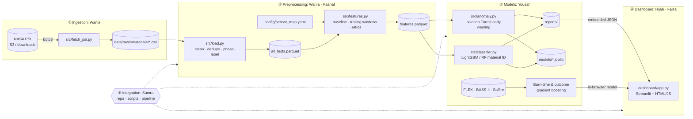
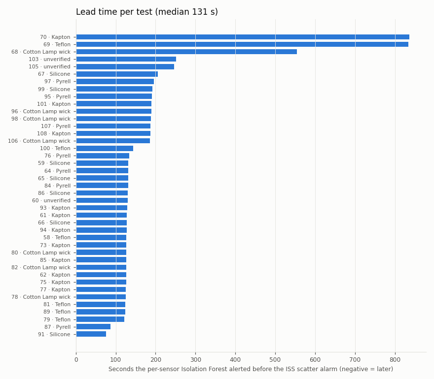

<div align="center">

# 🔥 Flame in Freefall

### AI-powered microgravity combustion analytics for spacecraft & habitat fire safety

**Team The Blueprint 67** · NASA International Space Apps Challenge


</div>

---

## Contents

1. [The problem](#-the-problem)
2. [What we built](#-what-we-built)
3. [Team](#-team-the-blueprint-67)
4. [Combustion physics in microgravity](#-combustion-physics-in-microgravity)
5. [NASA datasets](#-nasa-datasets)
6. [System architecture](#-system-architecture)
7. [Results](#-results)
8. [Repository structure](#-repository-structure)
9. [Quick start](#-quick-start)
10. [Limitations & honesty notes](#-limitations--honesty-notes)
11. [Acknowledgements](#-acknowledgements)

---

## 🚨 The problem

Fire is one of the most serious hazards on a spacecraft. A crew can't step outside, the atmosphere is a sealed, finite volume, and **flames in microgravity don't behave like flames on Earth**. Smoke detectors and fire-safety rules were largely designed around buoyant, Earth-gravity fires. On long missions, Gateway, lunar habitats and Mars transit, crews need earlier warnings and a better picture of *what* is burning.

## 🛰️ What we built

**Flame in Freefall** turns NASA's microgravity combustion experiments into a fire-safety intelligence dashboard:

- **⚡ Smoke early-warning detector.** Per-sensor Isolation Forests trained only on clean cabin air. They flag smoke **~2 minutes earlier** (median) than a scatter-based smoke alarm calibrated the same way.
- **🧪 Burning-material classifier.** LightGBM and Random Forest models identify which of 5 spacecraft materials is pyrolysing from aerosol-sensor signatures alone.
- **🔮 Flame-behaviour forecaster.** Gradient-boosted models trained on 274 FLEX droplet tests predict burn time and how a flame ends (extinction, disruption, completion). They run live in the browser as an interactive flame simulator.
- **📊 Flame analytics.** Interactive views of FLEX, BASS-II and Saffire-I: oxygen vs burn time, O₂ consumption, CO build-up, and flow direction effects.
- **🗂️ Dataset explorer.** Every source with provenance and a trust label (*NASA DATA* vs *UNVERIFIED*).

---

## 👩‍🚀 Team: The Blueprint 67

| | Member | Role | Contribution |
|:-:|---|---|---|
| 🗄️ | **Wania** | Data Engineer | Handled NASA PSI dataset ingestion via `boto3`, CSV telemetry subset extraction, and the preprocessing pipelines |
| 🤖 | **Yousaf** | ML & AI Lead | Built the anomaly detection, forecaster, and flame classifier models on microgravity combustion data |
| 🔌 | **Kashaf** | Embedded Systems & Sensor Lead | Designed the sensor data mapping and hardware telemetry integration |
| 🖥️ | **Hijab** | Frontend Developer | Built the web UI dashboard interface |
| 🎨 | **Faiza** | UI/UX & Domain Researcher | Designed the domain workflow, user experience layout, and pitch alignment |
| 🏗️ | **Samra** | GitHub Lead & Lead Systems Architect | Managed the repository structure, backend architecture, and final system integration |

**Where each person's work lives**

| Member | Primary paths |
|---|---|
| Wania | `src/fetch_psi.py`, `src/load.py`, `src/features.py`, `data/` |
| Yousaf | `src/anomaly.py`, `src/classifier.py`, `models/`, `reports/` |
| Kashaf | `config/sensor_map.yaml`, sensor channel definitions in `src/features.py` |
| Hijab | `dashboard/app.py` (UI) |
| Faiza | Dashboard workflow & layout, `docs/` |
| Samra | Repository layout, `scripts/`, pipeline integration, this README |

---

## 🔬 Combustion physics in microgravity

On Earth, a flame heats the surrounding gas, the hot gas rises (**buoyancy**), and fresh air is pulled in underneath. That convection gives a candle its teardrop shape, feeds it oxygen and carries smoke upward.

In orbit, buoyancy effectively disappears:

| | Earth (1 g) | Microgravity (µg) |
|---|---|---|
| Oxygen supply | Buoyant convection | Molecular **diffusion** + whatever the ventilation provides |
| Flame shape | Tall teardrop | Near-**spherical**, dimmer, often blue |
| Products (CO₂, H₂O, soot) | Carried away upward | Linger around the flame and can smother it |
| Controlling flow | Natural convection | **Cabin ventilation** (cm/s scale) dominates |
| Smoke | Rises to ceiling detectors | Drifts with the airflow; particle sizes differ |

Implications we build on:

- **Flow direction matters.** Saffire-I showed that a flame spreading *with* the airflow (concurrent) behaves very differently from one spreading *against* it (opposed). In a spacecraft, ventilation and not gravity sets the fire's behaviour.
- **Droplet flames follow the d²-law.** For an isolated fuel droplet the square of its diameter shrinks roughly linearly with time, so burn time scales with d₀². FLEX measured this for methanol and heptane under varied O₂ and diluent (He, CO₂). Our simulator animates this law using the ML-predicted burn time.
- **Cool flames exist.** FLEX found that heptane droplets can keep burning in a low-temperature "cool flame" mode after the visible hot flame goes out, a hazard that is invisible to the eye.
- **Smoke before flame.** Overheated materials (wire insulation, fabrics) **pyrolyse** and release smoke long before open flame. SAME measured this on the ISS, and it's the window where early detection saves a crew.

---

## 📡 NASA datasets

All data comes from NASA's **Physical Sciences Informatics (PSI)** system.

| Dataset | What it is | Size used | Used for | Trust |
|---|---|---|---|---|
| **SAME** (ISS, 2010) | Smoke Aerosol Measurement Experiment. 1 Hz housekeeping telemetry from 8 smoke/aerosol sensors while 5 materials are heated | 41 tests · 5 materials | Early-warning detector, material classifier, live telemetry view | ✅ NASA DATA |
| **FLEX** (PSI-69) | Flame Extinguishment Experiment. Isolated droplet combustion on the ISS | 274 tests | Burn-time & outcome models, flame simulator, analytics | ✅ NASA DATA |
| **BASS-II** (PSI-25) | Burning and Suppression of Solids | 129 burns | O₂ consumption and CO build-up analytics | ✅ NASA DATA |
| **Saffire-I** (PSI-98) | Large-scale fabric fire aboard an empty Cygnus cargo vehicle (2016) | 2 samples | Concurrent vs opposed flow comparison | ✅ NASA DATA |
| ACME CIR / FLEX-2 files | Extinction/suppression and cool-flame tables | small | Display only | ⚠️ UNVERIFIED |

**SAME materials:** Cotton lamp wick · Kapton · Pyrell · Silicone · Teflon

**Sensor channels** (mapping maintained in [`config/sensor_map.yaml`](config/sensor_map.yaml)):
ISS obscuration & scatter detectors · STS detector · Ionisation detectors A & B · P-Trak particle counter · DustTrak B · Gas plume temperature

**Data cleaning highlights** (`src/load.py`)
- Repeated header lines inside CSVs removed; all channels coerced to numeric
- Two byte-identical files found in two material folders → kept once, labelled `unverified` with both candidate materials
- One test dropped (heater never fired); broken DustTrak A channels dropped
- Each test split into **clean → heating → smoke** phases from the heater flag

---

## 🏗️ System architecture



**Design principles**

- **Live-safe features.** Every rolling feature uses *trailing* windows only, so anything computed at time *t* could have been computed onboard at time *t*.
- **Leakage-proof validation.** Splits are always **by test** (GroupKFold / leave-one-test-out), never by row.
- **Train on normal only.** The anomaly detector sees only clean air, so it can flag smoke from materials it has never seen.
- **Self-contained dashboard.** The UI ships results as an embedded payload and runs the flame models in the browser, so it works offline and needs no server-side model.

### Dashboard pages

| Page | What it shows |
|---|---|
| **Dashboard** | Replay of a SAME test: live sensor telemetry, AI fire-risk gauge, alarm comparison, live material classifier |
| **Flame analytics** | FLEX burn time vs O₂, extinction size, outcomes · BASS-II O₂ & CO · Saffire-I flow direction |
| **Dataset explorer** | Source provenance, FLEX test browser, CSV preview workspace |
| **AI intelligence** | Interactive microgravity flame simulator, model registry, feature drivers, unlabelled-test predictions |

---

## 📈 Results

### Smoke early-warning detector (SAME, 41 tests, 8-fold GroupKFold)

| Metric | Our detector | ISS-scatter-style alarm* |
|---|---|---|
| Tests detected | **41 / 41** | 41 / 41 |
| Median alert time after heater on | **3 s** | 134 s |
| 90th-percentile alert time | **5 s** | — |
| False alarms | **0.37 / hr** (1 test) | 0.74 / hr |
| Median lead over the alarm | **131 s** | — |

\*Baseline alarms are calibrated at the same false-alarm quantile for a fair comparison.



### Burning-material classifier (leave-one-test-out, 38 labelled tests)

| Model | Test-level accuracy | Macro-F1 | Window accuracy (120–600 s) |
|---|---|---|---|
| Random Forest (500 trees) | **73.7 %** (28/38) | 0.727 | 65.2 % |
| LightGBM (300 rounds) | 71.1 % (27/38) | 0.693 | **66.5 %** |

Chance level for 5 classes is 20 %. Accuracy grows from ~32 % at 60 s to ~71 % at 450 s of data. The strongest signals are the ion-B/ISS-scatter and scatter/obscuration ratios (SHAP).

### Flame forecaster (FLEX, 274 tests, 5-fold CV)

| Model | Task | Score |
|---|---|---|
| Gradient boosting (200 trees) | Burn time | R² 0.70 · ±3.1 s typical error |
| Gradient boosting (150 × 3) | Flame outcome | 77 % accuracy (baseline 69 %) |

Full outputs: [`reports/anomaly/summary.txt`](reports/anomaly/summary.txt) · [`reports/classifier/summary.txt`](reports/classifier/summary.txt) · technical and progress reports in [`docs/reports/`](docs/reports/)

---

## 📁 Repository structure

```
flame-in-freefall/
├── README.md
├── LICENSE
├── requirements.txt
├── .env.example               # PSI / AWS settings template (copy to .env)
├── .gitignore  .gitattributes
│
├── config/
│   └── sensor_map.yaml        # raw instrument columns → model channels
│
├── data/
│   ├── raw/<material>/        # SAME CSVs from NASA PSI      (git-ignored)
│   ├── external/              # other PSI downloads           (git-ignored)
│   └── processed/             # parquet intermediates         (git-ignored)
│       └── feature_columns.json   # feature lists per model  (committed)
│
├── src/
│   ├── fetch_psi.py           # Phase -1  boto3 download from NASA PSI
│   ├── load.py                # Phase 0   clean, dedupe, phase-label
│   ├── features.py            # Phase 1   baseline, rolling windows, ratios
│   ├── anomaly.py             # Phase 2   Isolation Forest early warning
│   └── classifier.py          # Phase 3   LightGBM / RF material classifier
│
├── models/                    # *.joblib (git-ignored, regenerated)
├── reports/
│   ├── anomaly/               # per-test results, sweep, figures
│   └── classifier/            # OOF predictions, SHAP importance, figures
│
├── dashboard/
│   └── app.py                 # Streamlit dashboard
│
├── notebooks/                 # exploration
├── docs/
│   └── reports/               # technical & progress reports (.docx)
└── scripts/
    └── run_pipeline.sh        # rebuild data → models → reports
```

---

## 🚀 Quick start

```bash
# 1. Clone
git clone https://github.com/samra761/flame-in-freefall.git
cd flame-in-freefall

# 2. Environment
python -m venv .venv
source .venv/bin/activate          # Windows: .venv\Scripts\activate
pip install -r requirements.txt

# 3. Just want the dashboard? It is self-contained:
streamlit run dashboard/app.py
```

**Rebuild the full pipeline from raw NASA data**

```bash
# Option A: download from S3 with boto3
cp .env.example .env               # fill in PSI_S3_BUCKET / PSI_S3_PREFIX
python src/fetch_psi.py

# Option B: download the SAME CSVs manually from https://psi.nasa.gov
#           and place them in data/raw/<material>/

bash scripts/run_pipeline.sh       # load → features → anomaly → classifier
```

---

## ⚖️ Limitations & honesty notes

- **Small sample.** 41 SAME tests and 5 materials. Results are promising, not flight-certified.
- **The early-warning lead is driven by plume temperature.** In all 41 tests the gas-plume thermocouple triggered the alert. With smoke sensors only, the median lead over the scatter alarm drops to about 1 s. A thermal channel near likely ignition sources is the key hardware recommendation.
- **Heated-sample smoke, not open flame.** SAME heats materials to pyrolysis, so it covers the pre-fire smoke window.
- **Three SAME tests have uncertain labels** (duplicate files). They are excluded from classifier training and shown separately as "unverified".
- Items tagged **UNVERIFIED** in the dashboard could not be matched to a NASA source and are illustrative only.

---

## 🙏 Acknowledgements

- **NASA Physical Sciences Informatics (PSI)** for the SAME, FLEX, BASS-II and Saffire datasets
- **NASA International Space Apps Challenge** organisers and local hosts
- The ISS and Cygnus combustion research teams whose experiments made this possible

<div align="center">

Built with 🔥 by **The Blueprint 67**: Samra · Wania · Yousaf · Kashaf · Hijab · Faiza

</div>
