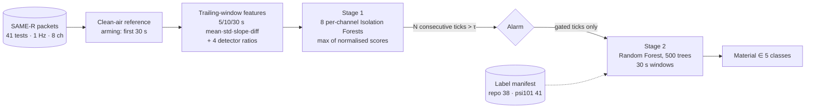

# Flame in Freefall: Causal Two-Stage Smoke Detection and Material Identification for Microgravity Fire Safety

**The Blueprint 67** · NASA Space Apps Challenge 2026 (Islamabad) · MCS NUST AI & ML Lab review

  

> **Reproduce every reported number in about 10 seconds, without training any model:**
> ```bash
> pip install -r requirements.txt && python scripts/verify_repo.py
> ```
> The script recomputes the headline tables from the committed per-test artifacts and checks dataset
> schema, label provenance, leakage guards and seeds. See [Reproducibility](#6-reproducibility).

---

## Contents
1. [Problem formulation](#1-problem-formulation)
2. [Dataset specification](#2-dataset-specification)
3. [Method](#3-method)
4. [Results](#4-results)
5. [Threats to validity](#5-threats-to-validity)
6. [Reproducibility](#6-reproducibility)
7. [Repository structure](#7-repository-structure)
8. [Dashboard and sensor integration layer](#8-dashboard-and-sensor-integration-layer)
9. [Team](#9-team)
10. [License, data terms and acknowledgements](#10-license-data-terms-and-acknowledgements)

---

## 1. Problem formulation

In microgravity there is no buoyant plume, so smoke from an overheating material stays near the source and spreads with cabin ventilation instead of rising to a ceiling detector. Overheated polymers and fabrics pyrolyse and release aerosol **before** open flame. That pre-ignition window is where detection is most valuable. The NASA SAME experiment measured this window on the ISS in 2010.

We pose two coupled tasks on the 1 Hz SAME housekeeping stream $\mathbf{x}_t \in \mathbb{R}^8$ (eight smoke, aerosol and temperature channels).

**Stage 1: causal anomaly detection (is something overheating?).** Learn a score $s_t = f(\mathbf{x}_{\le t})$ from clean cabin air only, and raise an alarm $a_t = \mathbb{1}[\min_{k<N} s_{t-k} > \tau]$ after $N$ consecutive anomalous ticks. The threshold $\tau$ is set on training-fold clean air at quantile $q = 1.0$, which means no sustained false alarm on calibration data. Metrics are detection rate, latency $t_{\text{alarm}} - t_0$ with $t_0$ = heater on, and false alarms per clean-air hour (FAR). The baseline is the ISS photoelectric scatter detector recalibrated to the same quantile.

**Stage 2: material identification (what is burning?).** Given an active Stage 1 alarm, classify the pyrolysing sample into one of five spacecraft materials $\mathcal{Y} = \{$Cotton lamp wick, Kapton, Pyrell, Silicone, Teflon$\}$ from trailing-window aerosol signatures.

**Chained causal setting.** Stage 2 runs only on ticks where Stage 1 is alarming, and every feature at tick $t$ uses samples $\le t$ only. Clean-air reference statistics come from a 30 s **arming** period after power-on (`arming`), not from the known heater-on time (`heater_oracle`, kept for comparison with earlier repository results but not deployable). Evaluation is leave-one-test-out (LOTO) over all 41 flight tests.

## 2. Dataset specification

**Source.** NASA Physical Sciences Informatics: SAME / SAME-R (PSI-101, PSI-102), ISS 2010. The experimental table `PSI-101_Experimental table_SAME-R.csv` lists each test's sample material, date, inlet velocity, heater resistance ratio and aging duration.

**Packet stream used by every Task 3-5 study.** `Sensor_Systems_and_Telemetry_Integration/ml_lead_handoff/SAME_R_WIDE_PACKETS.jsonl` contains 58,386 one-second packets, 41 tests and 8 channels, with every source timestamp validated against the NASA GMT label. SHA-256 `86c944d7…826982` is pinned in `FILE_CHECKSUMS.json` and in the chained-run metadata.

| Channel | Raw NASA column | Unit | Instrument |
|---|---|---|---|
| `iss_obs` | `ISSDetectorObscurationMeasurement(Volts)` | V | ISS smoke detector, light obscuration |
| `iss_sct` | `ISSDetectorScatterMeasurement(Volts)` | V | ISS smoke detector, light scatter (reference alarm) |
| `sts` | `STSDetectorMeasurement(Volts)` | V | STS smoke detector |
| `ion_a` | `IonDetectorAMeasurement(Volts)` | V | Ionisation detector A |
| `ion_b` | `IonDetectorBMeasurement(Volts)` | V | Ionisation detector B |
| `ptrak` | `PTrakMeasurement(PtPerCC)` | particles/cm³ | P-Trak ultrafine counter (`-999` sentinel → NaN) |
| `dtb` | `DustTrakBMeasurement(MgPerM3)` | mg/m³ | DustTrak B aerosol monitor |
| `plume_t` | `GasPlumeTemperature(DegC)` | °C | Gas-plume thermocouple above the heated sample |

The mapping lives in `config/sensor_map.yaml` and is checked against `src/features.py` by `verify_repo.py`. DustTrak A is dropped because of bad scaling. Heater flags, run mode, event codes and power states are never used as features.

**From 43 files to 41 tests.** NASA distributes 43 HKP CSVs in five material folders. `Pyrell/HKPData_gmt235_1` is dropped because the heater never fired. Two files are byte-identical copies in two folders (`HKPData_gmt211_4`: Pyrell/Silicone, giving test 60; `HKPData_gmt252_5`: Silicone/Teflon, giving tests 103 and 105). That leaves 40 files and 41 `TestNumber`s.

**Two label policies.** These are defined in `data/same_label_manifest.csv`, produced by `scripts/audit_same_tests.py` and loaded through `src/labels.py`.

| Policy | Supervised tests | Rule | Class counts (Cotton / Kapton / Pyrell / Silicone / Teflon) |
|---|---|---|---|
| `repo` | 38 | Folder material unambiguous; 60, 103 and 105 excluded | 7 / 11 / 7 / 7 / 6 |
| `psi101` | 41 | Adds 60 → Silicone, 103 → Silicone, 105 → Teflon, recovered from PSI-101 | 7 / 11 / 7 / 9 / 7 |

A label is recovered only if four audit checks pass. C1: input SHA-256 values match. C2: PSI-101 is a valid oracle, agreeing with the folder material on 38/38 verified tests and with the telemetry date within one day on 41/41. C3: exactly one burn row exists with an exact date match and a material among the candidate folders. C4: the run is a real fuel run, with heater duration and smoke response at least those of the weakest verified run. The classifier's own predictions for these tests are reported but never used in the ruling. Stage 1 uses no labels and always uses all 41 tests. Tests 67-70 had 720 s of primary aging (all others 11 s) and are reported separately ("excl. aged").

## 3. Method



| Component | Specification | Code |
|---|---|---|
| Baseline correction | Subtract clean-air median per channel (`arming`: first 30 s after power-on; `heater_oracle`: last 120 s before heater-on) | `src/evaluate_chained.py`, `src/features.py` |
| Features | 8 baseline-corrected values + 96 trailing-window statistics (3 windows × 4 statistics × 8 channels) = 104 detector features; + 4 noise-gated ratios = 108 classifier features. Windows run on a complete 1 Hz grid, so gaps are NaN and never bridged | `src/features.py` |
| Stage 1 | One `IsolationForest(n_estimators=200, max_samples=256)` per channel on `{value, mean10, slope10, std10}`, trained on clean air; per-channel scores normalised by the inner-fold clean-air 0.999 quantile; fused by max; threshold at q = 1.0 of inner out-of-fold sustained clean-air scores (4 inner folds) | `src/anomaly.py` (reused unchanged) |
| Stage 2 | `RandomForestClassifier(n_estimators=500, min_samples_leaf=2, max_features="sqrt", class_weight="balanced_subsample")`; 30 s windows with 10 s stride, described by the window mean of the 108 tick features plus per-channel max/min and the fraction of seconds each ratio is defined (128 features); per-test decision = mean window probability over 120-600 s; median imputation fit per fold | `src/evaluate_chained.py` |
| Validation | LOTO-41 (outer); every scaler, imputer, threshold, reference level and forest is fit on training folds only | `src/evaluate_chained.py` |
| Seeds | Single source `src/repro.py`, `SEED = 0` (see [§6](#6-reproducibility)) | `src/repro.py` |

**Leakage controls.** These are recorded in `results/chained_loto_metrics.json` and re-checked by `verify_repo.py`:
- **Future perturbation:** replacing every sample after heater-on + 60 s with N(0, 10³) noise leaves all features at or before the cut bit-identical (tests 58, 75, 91). The root unit tests repeat this on synthetic data for every rolling feature.
- **Streaming = batch:** a tick-by-tick streaming implementation reproduces the batch scores exactly (max |Δscore| = 0) with 100 % alarm and Stage 2 argmax agreement (tests 58, 69, 82, 96).
- **Grouped splits only:** no test ever contributes rows to both training and evaluation, in Stage 1 (GroupKFold / LOTO by test), Stage 2 (LOTO by test) or threshold calibration (inner GroupKFold on training tests).

## 4. Results

All numbers below are copied from committed artifacts. `python scripts/verify_repo.py` recomputes them from the per-test CSVs and fails if any of them disagree.

### 4.1 Stage 1: detection, chained causal LOTO-41

Source: `results/chained_loto_summary.md`. Latency is measured from heater-on. FAR is false alarms per clean-air hour. The ISS columns are the scatter detector recalibrated to the same clean-air quantile.

| Baseline | N ticks | Detected | Median latency (s) | P90 (s) | FAR / clean h | ISS scatter detected | ISS median (s) | ISS FAR / h |
|---|---|---|---|---|---|---|---|---|
| **arming** (causal) | 1 | 41/41 | 1.0 | 3.0 | 1.27 | 41/41 | 131.0 | 0.42 |
| **arming** (causal) | 2 | 41/41 | 2.0 | 4.0 | 0.00 | 41/41 | 133.0 | 0.42 |
| **arming** (causal) | 3 | 41/41 | 3.0 | 5.0 | 2.11 | 41/41 | 133.0 | 0.42 |
| heater_oracle | 1 | 41/41 | 80.0 | 191.0 | 0.37 | 40/41 | 133.0 | 1.11 |
| heater_oracle | 2 | 41/41 | 2.0 | 4.0 | 1.11 | 40/41 | 133.0 | 1.11 |
| heater_oracle | 3 | 41/41 | 3.0 | 5.0 | 2.22 | 41/41 | 134.0 | 0.74 |

Earlier standalone result in the repository (8-fold GroupKFold, heater baseline, N = 3): 41/41 detected, median 3.0 s, P90 5.0 s, FAR 0.37/h; ISS 134.0 s, 0.74/h.

### 4.2 Stage 2: material identification

Source: `results/chained_loto_summary.md`. **Oracle** = heater-aligned windows starting 120-570 s, with probabilities averaged per test (the repository protocol). **Chained** = Stage 2 evaluated only on ticks with an active Stage 1 alarm. Chance level is 0.20.

| Baseline / labels | Oracle acc | Oracle macro-F1 | Oracle acc excl. 720 s-aged |
|---|---|---|---|
| arming / psi101 | 0.756 (31/41) | 0.747 | 0.838 (31/37) |
| arming / repo | 0.711 (27/38) | 0.704 | 0.765 (26/34) |
| heater_oracle / psi101 | 0.756 (31/41) | 0.746 | 0.838 (31/37) |
| heater_oracle / repo | 0.684 (26/38) | 0.658 | 0.765 (26/34) |

Chained, operating point N = 3:

| Baseline / labels | First-alert acc | Until-600 s acc | Steady-state acc | Steady macro-F1 | Steady acc excl. aged | Share of errors in transient (0-120 s) |
|---|---|---|---|---|---|---|
| **arming / psi101** | 0.268 (11/41) | 0.707 | **0.805 (33/41)** | **0.800** | **0.892** | 0.59 |
| arming / repo | 0.237 (9/38) | 0.711 | 0.763 (29/38) | 0.754 | 0.853 | 0.61 |
| heater_oracle / psi101 | 0.268 (11/41) | 0.732 | 0.825 (33/40) | 0.820 | 0.892 | 0.57 |
| heater_oracle / repo | 0.263 (10/38) | 0.684 | 0.811 (30/37) | 0.812 | 0.882 | 0.57 |

The N = 1 and N = 2 rows are in `results/chained_loto_summary.md`. Earlier repository Stage 2 baselines (heater-aligned, LOTO-38, `repo` labels, from `chained_loto_metrics.json` → `repo_reference`): Random Forest 28/38 (0.737, macro-F1 0.727); LightGBM 27/38 (0.711, 0.693); LightGBM without plume temperature 22/38 (0.579, 0.540); LightGBM with ratios only 23/38 (0.605, 0.529).

### 4.3 Per-sensor sensitivity, LOTO-41, t₀ = heater on

Source: `reports/sensor_sensitivity/sensor_table_loto.md`. Each row is the Stage 1 detector restricted to that one channel. Material F1 is the LOTO-38 Random Forest macro-F1 using only that channel's features.

| Rank | Sensor channel | Type | Detected | Det. acc. | Det. F1 | False alarms /h | Median delay (s) | P90 delay (s) | Δ median vs 8-ch (s) | Beats ISS alarm | Material F1 (alone) |
|---|---|---|---|---|---|---|---|---|---|---|---|
| 1 | Gas plume temp. (`plume_t`) | thermocouple | 41/41 | 0.99 | 0.99 | 0.37 | 3 | 5 | 0 | 41/41 | 0.59 |
| 2 | ISS obscuration (`iss_obs`) | optical smoke | 41/41 | 0.99 | 0.99 | 0.37 | 131 | 198 | 128 | 31/41 | 0.51 |
| 3 | ISS scatter (`iss_sct`) | optical smoke | 40/41 | 0.98 | 0.98 | 1.11 | 134 | 252 | 131 | 1/41 | 0.41 |
| 4 | DustTrak B (mass) (`dtb`) | aerosol mass | 41/41 | 1.00 | 1.00 | 0.00 | 136 | 259 | 133 | 11/41 | 0.24 |
| 5 | Ionisation A (`ion_a`) | ionisation smoke | 32/41 | 0.88 | 0.86 | 0.37 | 136 | 253 | 134 | 0/41 | 0.35 |
| 6 | Ionisation B (`ion_b`) | ionisation smoke | 40/41 | 0.98 | 0.98 | 1.11 | 142 | 738 | 138 | 4/41 | 0.24 |
| 7 | P-Trak (ultrafine) (`ptrak`) | particle counter | 41/41 | 0.99 | 0.99 | 0.37 | 147 | 665 | 144 | 2/41 | 0.15 |
| 8 | STS detector (`sts`) | optical smoke | 1/41 | 0.51 | 0.05 | 0.00 | 1016 | 1016 | 1013 | 0/41 | 0.24 |

| Reference | Type | Detected | Det. acc. | Det. F1 | False alarms /h | Median delay (s) | P90 delay (s) | Δ median vs 8-ch (s) | Material F1 |
|---|---|---|---|---|---|---|---|---|---|
| Full 8-channel detector | baseline | 41/41 | 0.98 | 0.98 | 0.74 | 3 | 5 | 0 | 0.69 |
| ISS scatter alarm (standard) | reference threshold | 41/41 | 0.99 | 0.99 | 0.74 | 134 | 250 | 131 | – |
| Ionisation A alarm (standard) | reference threshold | 37/41 | 0.94 | 0.94 | 0.37 | 136 | 221 | 133 | – |

Greedy forward selection (`reports/sensor_sensitivity/greedy_selection_loto.csv`) gives these material macro-F1 values: plume temperature 0.59 (25/38) → + ISS obscuration 0.78 (29/38) → + P-Trak 0.77 → + Ionisation B 0.79 (30/38). With all 8 channels it drops to 0.69 (27/38) because the extra channels add noise for the classifier. Every greedy subset keeps the 3 s median detection latency. The two-channel subset (plume temperature + ISS obscuration) needs 8 B/s of telemetry at 1 Hz float32 instead of 32 B/s. Because the subset was chosen on the same CV results, its F1 is optimistic (see §5). Figures (300 DPI PNG and PDF): `reports/sensor_sensitivity/figures/latency_per_sensor_loto.*` and `greedy_selection_loto.*`.

### 4.4 Real-time cost

Single-thread streaming implementation, CPU latency per 1 Hz tick (source: `results/chained_loto_summary.md`, tests 58, 69, 82 and 96 replayed):

| Ticks | n | Mean (ms) | P50 (ms) | P99 (ms) | Max (ms) |
|---|---|---|---|---|---|
| all armed ticks | 6193 | 85.13 | 58.71 | 269.11 | 547.52 |
| Stage 1 only | 3970 | 80.86 | 51.39 | 244.82 | 547.52 |
| Stage 1 + Stage 2 | 2223 | 92.75 | 64.28 | 282.24 | 458.81 |

The worst-case tick uses about 55 % of the 1000 ms budget at 1 Hz.

## 5. Threats to validity

1. **The 3 s latency comes from the plume thermocouple.** That channel triggers every detection and sits directly above the heated sample, so part of its response is the heater itself. With smoke channels only, the best single sensor (ISS obscuration) has a median of 131 s. This is the conservative figure for a cabin detector away from the source.
2. **Small samples.** There are 41 tests (38 labelled under `repo`), so each test is about 2.4-2.6 percentage points of accuracy. Clean-air exposure is 2.37 h (`arming`) or 2.71 h (`heater_oracle`), so FAR differences rest on 0-6 events. The non-monotone FAR across N (`arming`: 1.27 → 0.00 → 2.11 /h) reflects this granularity, not a systematic trend.
3. **Detection F1 saturates near 1.** Each test contributes one fire event and one clean period, so latency is the discriminating metric.
4. **The subset choice is optimistic.** The greedy subset was selected on the same CV results it is scored on.
5. **Label recovery.** Tests 60, 103 and 105 use PSI-101 labels. Results are reported under both policies, and `repo` reproduces the original 38-test protocol exactly.
6. **Software drift.** Tree ensembles can change by a test when library versions change. For example, the sensor study records one extra clean-air false alarm (test 64) with scikit-learn 1.9, and RF 27/38 vs 28/38. `requirements.txt` pins the exact versions of the reference run.
7. **Scope.** SAME heats samples to pyrolysis and has no open flaming, so the models cover the pre-ignition smoke phase only.

## 6. Reproducibility

### 6.1 Environment

```bash
git clone https://github.com/Samra761/The-Blueprint-67.git
cd The-Blueprint-67
python3.11 -m venv .venv && source .venv/bin/activate     # Windows: .venv\Scripts\activate
pip install -r requirements.txt
# or:  conda env create -f environment.yml && conda activate flame-in-freefall
```

`requirements.txt` pins `numpy==2.4.6`, `pandas==3.0.3` and `scikit-learn==1.9.0`, the exact versions recorded in `results/chained_loto_metrics.json` for the committed run on Python 3.11.9. Every other package is pinned to a release whose PyPI metadata supports Python 3.11, and the file marks how each pin was established.

### 6.2 Fast verification (no training, about 10 s)

```bash
python scripts/verify_repo.py          # or: make verify
```

| Check group | What it proves |
|---|---|
| `env`, `compile` | Python ≥ 3.11, pinned core packages, every module byte-compiles and the core modules import |
| `seed` | One seed source (`src/repro.py`), no hard-coded seeds in `src/`, active seed = seed of the committed results |
| `data` | 58,386 packets × 8 channels × 41 heated tests; SHA-256 = `FILE_CHECKSUMS.json` = chained-run input; feature list and `sensor_map.yaml` agree with `src/features.py` |
| `labels` | Manifest consistent (38 / 41 policies) and identical to the chained-run input; the packet stream matches it test by test |
| `audit` | `scripts/audit_same_tests.py` re-runs into a temp dir and reproduces the committed audit byte-for-byte (timestamp excluded) |
| `chained` | Stage 1 detection, latency and FAR and the chained accuracies recomputed from `chained_loto_per_test.csv`; latency percentiles from `chained_loto_latency_ms.csv`; Stage 1 identical under both label policies; leakage self-checks passed; `summary.md` re-rendered byte-identically |
| `sensors` | All 24 study files present; 300 DPI figures; all 255 channel subsets (LOTO and 8-fold) recomputed from `per_test_*.csv.gz`; Markdown table = CSV |
| `causality` | Trailing-window and ratio features are bit-identical up to *t* after the future is replaced by noise |
| `tests` | 16 root unit tests (`tests/`) and 23 sensor-workspace tests |

Exit code 0 means no failures. Warnings (for example a library version that differs from the reference run, or optional packages such as LightGBM that are absent) are reported but do not fail the run.

### 6.3 Full reproduction (hours; overwrites `results/` and `reports/`)

```bash
python scripts/verify_repo.py --full --dry-run   # list the stages
python scripts/verify_repo.py --full             # run them (or: make full)
```

| Stage | Command | Needs `data/raw/` | Approx. time |
|---|---|---|---|
| Label audit | `python scripts/audit_same_tests.py` | no | 2 s |
| Load + label check | `python src/load.py` | yes | 1 min |
| Features | `python src/features.py` | yes | 1 min |
| Stage 1, 8-fold | `python src/anomaly.py` | yes | 10-15 min |
| Stage 2, LOTO-38 | `python src/classifier.py` | yes | 5 min |
| Sensor sensitivity | `python src/sensor_sensitivity.py` | no | about 1.5 h (2 vCPU) |
| Chained LOTO-41 | `python src/evaluate_chained.py` | no | about 1.3 h (4619 s recorded) |

The raw SAME CSVs are not committed. Fetch them from NASA PSI with `python src/fetch_psi.py` (configure `.env` from `.env.example`) into `data/raw/<material>/`. `src/load.py` now aborts if the loaded tests disagree with `data/same_label_manifest.csv`.

### 6.4 Seeds

Every stochastic component reads `SEED` from `src/repro.py`. **The canonical value is 0**, because every committed artifact was produced with seed 0 (`meta.seed` in `chained_loto_metrics.json`). A seed-robustness study can override it without code changes, for example `FIF_SEED=42 python src/evaluate_chained.py`. `verify_repo.py` then warns that the committed numbers are no longer the ones being reproduced.

## 7. Repository structure

```
The-Blueprint-67/
├── README.md                 this document
├── requirements.txt          pinned environment (Python 3.11)
├── environment.yml           conda equivalent
├── Makefile                  verify / test / full / dashboard shortcuts
├── pytest.ini                root test configuration
├── config/sensor_map.yaml    raw NASA column → channel mapping
├── data/
│   ├── same_label_manifest.csv   41-test label manifest (input to src/labels.py)
│   ├── processed/feature_columns.json   feature contract (other intermediates git-ignored)
│   └── raw/<material>/       NASA SAME CSVs (git-ignored; src/fetch_psi.py)
├── src/
│   ├── repro.py              single seed source
│   ├── labels.py             label manifest loader, policies, loader consistency check
│   ├── fetch_psi.py          NASA PSI download (boto3)
│   ├── load.py               clean, phase-label, manifest-check raw CSVs
│   ├── features.py           causal trailing-window features
│   ├── anomaly.py            Stage 1 per-channel Isolation Forest detector
│   ├── classifier.py         legacy Stage 2 (LightGBM / RF, LOTO-38)
│   ├── sensor_sensitivity.py Task 4: per-sensor and subset ablation
│   └── evaluate_chained.py   Task 5: causal chained LOTO-41 + latency + leakage checks
├── scripts/
│   ├── verify_repo.py        fast verification / --full reproduction
│   ├── audit_same_tests.py   Task 3: PSI-101 label audit
│   └── run_pipeline.sh       legacy raw-data pipeline
├── tests/test_core.py        unit tests: labels, causality, seeds
├── results/                  Task 3 + Task 5 artifacts (JSON / CSV / MD)
├── reports/
│   ├── anomaly/              legacy Stage 1 (8-fold) tables and figures
│   ├── classifier/           legacy Stage 2 (LOTO-38) tables and figures
│   └── sensor_sensitivity/   Task 4 tables and 300 DPI figures
├── dashboard/app.py          Streamlit dashboard
├── Sensor_Systems_and_Telemetry_Integration/   telemetry packets, registry, adapter (v2.1.6)
├── docs/reports/             technical report (PDF, DOCX)
└── models/                   trained binaries (git-ignored)
```

## 8. Dashboard and sensor integration layer

`streamlit run dashboard/app.py` opens an offline dashboard with eight pages: live SAME test replay with risk score, alarm comparison and material prediction; FLEX, BASS-II and Saffire-I flame analytics; a dataset explorer with per-source provenance; a FLEX flame simulator running in the browser; model status; sensor profiles; telemetry streams; and the variable registry. The dashboard reads the sensor integration workspace (`Sensor_Systems_and_Telemetry_Integration/`, package v2.1.6). That workspace normalises seven PSI source tables, SAME-R (PSI-101/102) and Saffire-III (PSI-100) into validated, timestamped packets with provenance. No timestamps are fabricated, and instrument error codes are kept as nulls with a quality flag. Its own documentation is in `Sensor_Systems_and_Telemetry_Integration/README.md`.

The FLEX burn-time and flame-outcome models embedded in the dashboard are described in `docs/reports/`. They are outside the scope of `verify_repo.py`.

## 9. Team

**The Blueprint 67**

| Member | Role | Contribution |
|---|---|---|
| Samra Mehmood | Team Lead, GitHub Lead & Lead Systems Architect | Repository architecture, reproducibility pipeline, system integration, review audit |
| Yousaf | ML & AI Lead | Anomaly detection, material classification, chained evaluation |
| Wania | Data Engineer | NASA PSI ingestion, preprocessing, telemetry subsets |
| Kashaf | Embedded Systems & Sensor Lead | Sensor channel mapping, telemetry integration, sensitivity analysis |
| Hijab | Frontend Developer | Dashboard interface |
| Faiza | UI/UX & Domain Researcher | Domain research, workflow and user-experience design |

### Citation

```bibtex
@software{blueprint67_flame_in_freefall_2026,
  title  = {Flame in Freefall: Causal Two-Stage Smoke Detection and Material
            Identification for Microgravity Fire Safety},
  author = {Samra, Yousaf, Kashaf, Hijab, Faiza},
  year   = {2026},
  url    = {https://github.com/Samra761/The-Blueprint-67}
}
```

## 10. License, data terms and acknowledgements

Copyright (c) 2026 The Blueprint 67. Licensed under the GNU Affero General Public License v3.0 (see `LICENSE`). If you distribute a modified version or run it as a public network service, you must release its source under the same license and credit the original authors. NASA data is subject to the NASA PSI terms of use (https://psi.nasa.gov).

We thank NASA Physical Sciences Informatics and the SAME, FLEX, BASS-II and Saffire research teams for the flight datasets, and the organisers of the NASA Space Apps Challenge 2026 and its Islamabad event.
