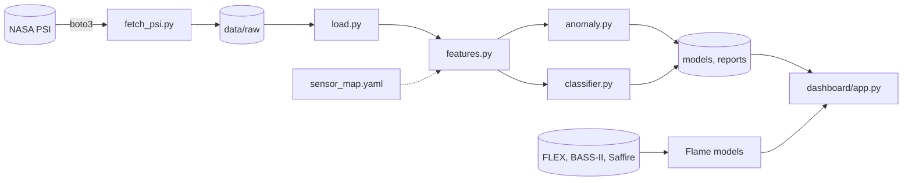

# Flame in Freefall: Microgravity Combustion 

Fire-safety insights and anomaly detection for spacecraft and habitats, built on NASA Physical Sciences Informatics (PSI) data.

Developed by team The Blueprint 67 for the NASA Space Apps Challenge 2026, Local Event: Islamabad.


## Overview

Fire behaves differently in orbit. Without buoyancy there is no rising plume, oxygen reaches the flame mainly by diffusion and cabin ventilation, and smoke does not collect at the ceiling where detectors on Earth expect it. Most fire-safety practice was developed for Earth gravity, so longer missions need detection and decision support designed for these conditions.

Flame in Freefall combines four NASA microgravity combustion datasets into a single dashboard and a set of models:

- An early-warning smoke detector trained only on clean cabin air, using one Isolation Forest per sensor.
- A classifier that identifies which of five spacecraft materials is overheating from aerosol sensor signatures.
- Burn-time and flame-outcome models trained on FLEX droplet tests, used by an interactive flame simulator.
- Analytics views for FLEX, BASS-II and Saffire-I, with each data source labelled by provenance.

## Team

| Member | Role | Contribution |
|---|---|---|
| Wania | Data Engineer | NASA PSI dataset ingestion via boto3, CSV telemetry subset extraction, preprocessing pipelines |
| Yousaf | ML & AI Lead | Anomaly detection, forecaster and flame classifier models on microgravity combustion data |
| Kashaf | Embedded Systems & Sensor Lead | Sensor data mapping and hardware telemetry integration |
| Hijab | Frontend Developer | Web UI dashboard interface |
| Faiza | UI/UX & Domain Researcher | Domain workflow, user experience layout, pitch alignment |
| Samra | GitHub Lead & Lead Systems Architect | Repository structure, backend architecture, final system integration |

## Background: combustion in microgravity

On Earth, hot combustion gases rise and draw fresh air in beneath the flame. This buoyant flow shapes the flame, supplies oxygen and carries smoke upward. In microgravity that flow is absent:

| | Normal gravity | Microgravity |
|---|---|---|
| Oxygen transport | Buoyant convection | Diffusion and forced ventilation |
| Flame shape | Elongated | Approximately spherical, dimmer |
| Combustion products | Carried away | Accumulate near the flame |
| Dominant flow | Natural convection | Cabin ventilation, on the order of cm/s |

Several results from the source experiments shape this project:

- Flow direction controls flame spread. Saffire-I burned large fabric samples aboard a Cygnus vehicle and showed clear differences between flames spreading with and against the airflow.
- Isolated fuel droplets follow the d²-law: the square of the droplet diameter decreases roughly linearly in time, so burn time scales with the initial diameter squared. FLEX measured this for methanol and heptane under varying oxygen and diluent concentrations.
- Heptane droplets in FLEX continued burning as low-temperature cool flames after visible extinction.
- Overheated materials pyrolyse and release smoke before any open flame. The SAME experiment measured this on the ISS, and this pre-ignition window is where early detection is most valuable.

## Data

All datasets are from NASA PSI.

| Dataset | Description | Used | Purpose |
|---|---|---|---|
| SAME (ISS, 2010) | Smoke Aerosol Measurement Experiment; 1 Hz telemetry from eight smoke and aerosol sensors while samples are heated | 41 tests, 5 materials | Early warning, material classification, telemetry replay |
| FLEX (PSI-69) | Flame Extinguishment Experiment; isolated droplet combustion | 274 tests | Burn-time and outcome models, analytics |
| BASS-II (PSI-25) | Burning and Suppression of Solids | 129 burns | Oxygen consumption and CO analysis |
| Saffire-I (PSI-98) | Large-scale fabric fire aboard Cygnus, 2016 | 2 samples | Flow-direction comparison |

SAME materials: cotton lamp wick, Kapton, Pyrell, silicone, Teflon.

SAME sensor channels are mapped in `config/sensor_map.yaml`: ISS obscuration and scatter detectors, STS detector, ionisation detectors A and B, P-Trak particle counter, DustTrak B, and gas plume temperature.

Preprocessing (`src/load.py`, `src/features.py`):

- Removes repeated header rows and coerces channels to numeric.
- Detects two files duplicated across material folders, keeps one copy of each and marks those tests as unverified.
- Drops one test in which the heater never fired, and the faulty DustTrak A channels.
- Labels each test into clean, heating and smoke phases from the heater flag.
- Baseline-corrects each test against its clean-air period and computes trailing-window features, so every feature at time t is available in real time.

Two supplementary files (ACME CIR and FLEX-2 tables) could not be matched to a NASA source. They are shown in the dashboard as unverified and are not used for modelling.

## Architecture



| Stage | Component | Output |
|---|---|---|
| Ingestion | `src/fetch_psi.py` | `data/raw/<material>/*.csv` |
| Cleaning | `src/load.py` | `data/processed/all_tests.parquet` |
| Features | `src/features.py` | `data/processed/features.parquet` |
| Early warning | `src/anomaly.py` | `models/anomaly_iforest.joblib`, `reports/anomaly/` |
| Classification | `src/classifier.py` | `models/material_classifier.joblib`, `reports/classifier/` |
| Dashboard | `dashboard/app.py` | Streamlit application |

Validation always splits by test (GroupKFold or leave-one-test-out), never by row, so no test contributes to both training and evaluation. The dashboard embeds its results and runs the flame models in the browser, so it works offline with no model server.

The dashboard has four pages: a live replay of SAME tests with a fire-risk score and material prediction; flame analytics across FLEX, BASS-II and Saffire-I; a dataset explorer with source provenance; and a model page with the interactive flame simulator.

## Results

### Early-warning detector

SAME, 41 tests, 8-fold GroupKFold. The baseline is an ISS-scatter alarm calibrated to the same false-alarm quantile.

| Metric | Detector | Scatter alarm |
|---|---|---|
| Tests detected | 41 / 41 | 41 / 41 |
| Median alert time after heater on | 3 s | 134 s |
| 90th percentile alert time | 5 s | n/a |
| False alarm rate | 0.37 per hour | 0.74 per hour |
| Median lead over scatter alarm | 131 s | n/a |


### Material classifier

Leave-one-test-out on 38 labelled tests. Chance accuracy is 20%.

| Model | Test accuracy | Macro F1 | Window accuracy (120 to 600 s) |
|---|---|---|---|
| Random Forest, 500 trees | 73.7% (28/38) | 0.727 | 65.2% |
| LightGBM, 300 rounds | 71.1% (27/38) | 0.693 | 66.5% |

Accuracy increases from about 32% with 60 s of data to about 71% with 450 s. The most informative features are the ratios of ionisation-B to scatter and of scatter to obscuration.

### Flame models

FLEX, 274 tests, 5-fold cross-validation.

| Model | Target | Score |
|---|---|---|
| Gradient boosting, 200 trees | Burn time | R² 0.70, typical error 3.1 s |
| Gradient boosting, 150 trees per class | Flame outcome | 77% accuracy (majority baseline 69%) |

Detailed outputs are in `reports/anomaly/summary.txt` and `reports/classifier/summary.txt`. The technical and progress reports are in `docs/reports/`.

## Limitations

- The SAME set is small: 41 tests and five materials.
- The detector's lead time comes mostly from the gas plume temperature channel, which triggered the alert in all 41 tests. Using smoke sensors alone, the median lead over the scatter alarm falls to about 1 s. A temperature sensor near likely ignition sources is therefore the main hardware recommendation.
- SAME heats samples to pyrolysis and does not include open flaming, so the detector covers the pre-ignition smoke phase only.
- Three SAME tests have uncertain material labels. They are excluded from classifier training and reported separately.

## Repository structure

```
flame-in-freefall/
├── config/            sensor channel mapping
├── dashboard/         Streamlit application
├── data/
│   ├── raw/           NASA CSVs, not tracked
│   ├── external/      other downloads, not tracked
│   └── processed/     intermediates, not tracked except feature_columns.json
├── docs/reports/      technical and progress reports
├── models/            trained models, not tracked
├── notebooks/
├── reports/           evaluation tables and figures
├── scripts/           pipeline and setup scripts
└── src/               ingestion, preprocessing and model code
```

## Getting started

Requires Python 3.11 or later.

```bash
git clone https://github.com/Samra761/flame-in-freefall.git
cd flame-in-freefall
python -m venv .venv
source .venv/bin/activate        # Windows: .venv\Scripts\activate
pip install -r requirements.txt
```

Run the dashboard:

```bash
streamlit run dashboard/app.py
```

To rebuild models and reports from raw data, place the SAME CSV files in `data/raw/<material>/`, either by downloading them from https://psi.nasa.gov or by configuring `.env` (see `.env.example`) and running `python src/fetch_psi.py`. Then run:

```bash
bash scripts/run_pipeline.sh
```

## License

Copyright (c) 2026 The Blueprint 67 (Samra, Wania, Yousaf, Kashaf, Hijab, Faiza).

This project is licensed under the GNU Affero General Public License v3.0. See `LICENSE` for the full text. You may use and study this code, but any modified version you distribute or run as a public web service must credit the original authors and be released under the same license with its source code. NASA data is subject to NASA PSI terms of use.

## Acknowledgements

We thank NASA Physical Sciences Informatics for the SAME, FLEX, BASS-II and Saffire datasets, the organisers of the NASA Space Apps Challenge 2026 and the Islamabad local event, and the research teams behind these ISS and Cygnus experiments.
